# TemanBicara

Platform konseling dan kesehatan mental. Pasien bisa memesan sesi dengan psikolog, berbagi cerita dengan relawan pendengar sebaya, dan admin memantau seluruh platform.

🔗 **[Demo live](https://temanbicara.site)**

## Peran Pengguna

TemanBicara membagi hak akses dan fitur ke dalam empat portal kerja, masing-masing dengan dashboard sendiri.

### 1. Pasien
- Booking sesi privat dengan psikolog klinis berlisensi (SIPPK), termasuk reschedule dan pembatalan dengan refund otomatis sesuai kebijakan
- Curhat anonim dengan relawan pendengar sebaya lewat tiket curhat, plus riwayat curhat
- Mode Anonim: identitas disamarkan selama sesi, dan juga di tampilan admin
- Chat sesi berupa pesan teks, gambar, dan pesan suara
- Dompet koin: top-up via Midtrans, kirim tip, dan beri ulasan setelah sesi
- Kontak darurat, dan tombol lapor krisis saat sesi berlangsung

### 2. Psikolog
- Jadwal mingguan dan waktu libur yang diatur sendiri
- Ruang sesi dengan chat terintegrasi, serta catatan sesi dan riwayat klien
- Honor sesi dan pengajuan payout ke rekening bank
- Pengaturan ketersediaan. Pembatalan sepihak dan tidak hadir dikenai sistem strike dan penangguhan otomatis

### 3. Relawan Pendengar Sebaya
- Antrean curhat anonim yang diklaim sendiri, dengan batas beban harian
- Status siaga untuk mengatur ketersediaan menerima tiket
- Panduan etika mendengarkan aktif dan penanganan percakapan berisiko
- Riwayat curhat, tip dan honor, serta pengajuan payout

### 4. Administrator
- Verifikasi berkas legalitas mitra (psikolog dan relawan)
- Antrean payout, penanganan sengketa, dan audit transaksi koin
- Feed eskalasi krisis untuk tindak lanjut laporan darurat
- Moderasi ulasan dan pengelolaan status akun pengguna
- Log aktivitas (login, aksi admin, sesi, uang, keselamatan) dan pengaturan sistem yang beraudit

## Fitur Utama

- **Multi-peran:** Pasien, Psikolog, Relawan Pendengar Sebaya, dan Admin, masing-masing dengan akses dan dashboard sendiri
- **Booking sesi:** pilih psikolog dan jadwal, reschedule, dan batalkan dengan refund otomatis sesuai kebijakan
- **Chat sesi:** pesan teks, gambar, dan pesan suara dalam satu ruang sesi
- **Curhat sebaya:** antrean tiket curhat anonim yang diklaim relawan, dengan batas beban harian
- **Koin dan pencairan:** top-up koin via Midtrans, tip, dan pengajuan payout honor untuk mitra
- **Keuangan yang aman:** buku besar (ledger) append-only, penahanan dana saat refund/chargeback, dan layar admin untuk menyelesaikan sengketa
- **Dashboard admin:** verifikasi mitra, antrean payout, sengketa, feed eskalasi krisis, log aktivitas, dan pengaturan sistem beraudit
- **Responsif:** tata letak dan ruang chat dirapikan untuk layar HP

## Tech Stack

- **Framework:** Next.js 15 (App Router, Turbopack, Route Handlers sebagai API) dan React 19
- **Backend dan autentikasi:** Supabase (PostgreSQL, RLS, Realtime, Google OAuth)
- **Pembayaran:** Midtrans (sandbox)
- **Bahasa:** TypeScript
- **Styling:** Tailwind CSS 4, Shadcn UI (Radix UI)
- **State:** Zustand
- **Validasi dan formulir:** Zod, React Hook Form
- **Pengujian:** Vitest
- **Lainnya:** Lucide React dan React Icons, Date-fns, Sonner, Vercel

## Arsitektur Singkat

```
Browser (Next.js App Router, React 19)
   │  cookie HttpOnly
   ▼
API Route Next.js  ── validasi Zod, cek sesi & peran
   │  service role (hanya di server)
   ▼
Supabase PostgreSQL ── RLS, RPC transaksional (saldo, ledger, sengketa), pg_cron
   ▲
Midtrans (sandbox) ── webhook top-up, refund, chargeback
```

Semua mutasi uang (top-up, bayar sesi, tip, payout, potong saldo sengketa) berjalan di fungsi PostgreSQL yang atomik dan tercatat di ledger yang tidak bisa diubah.

## Pengujian

188 tes otomatis (Vitest) untuk alur yang paling berisiko:

| Area | Contoh yang diuji |
|---|---|
| Uang | webhook Midtrans (idempoten, refund, chargeback), payout, tip, resolusi sengketa |
| Login & sesi | token tidak valid, akun ditangguhkan/ditolak, proteksi rute cron |
| Validasi | skema auth, dokumen mitra, path media sesi (anti path traversal) |
| Booking | tarif koin, aturan refund, aturan reschedule, jendela ruang sesi |
| Log aktivitas | filter kategori, pencarian nama, rentang tanggal, samaran Mode Anonim |

```bash
npm test
```

Migrasi SQL juga diuji dengan skrip dry-run transaksional di PostgreSQL sungguhan (folder migrasi disimpan privat, tidak dipublikasikan di repo ini).

## Mencoba Top-up (Sandbox)

Pembayaran memakai **Midtrans sandbox**, jadi tidak ada uang sungguhan. Saat top-up koin, pakai kartu uji resmi Midtrans:

| Nomor kartu | Masa berlaku | CVV |
|---|---|---|
| `4811 1111 1111 1114` | `12/30` | `123` |

## Keamanan

- Autentikasi memakai cookie HttpOnly dan JWT Supabase yang diverifikasi di server
- Row Level Security di database, dan akses service role hanya dari server
- Validasi input di server dengan Zod, dan pesan error tidak membocorkan detail database
- Webhook Midtrans diverifikasi signature-nya dan diproses secara idempoten
- Log aktivitas bersifat append-only dan menyamarkan identitas pasien Mode Anonim

## Menjalankan Secara Lokal

Prasyarat: Node.js 20 atau lebih baru.

```bash
git clone https://github.com/wxhyxtrx/temanbicara-app.git
cd temanbicara-app
npm install
cp .env.example .env.local   # isi variabel Supabase & Midtrans sandbox
npm run dev
```

Buka [http://localhost:3000](http://localhost:3000). Akun Psikolog dan Relawan memerlukan verifikasi Admin. Akun Admin tidak bisa didaftarkan lewat halaman register dan dibuat langsung di proyek Supabase. Untuk login Google, aktifkan provider Google di Supabase dan tambahkan `http://localhost:3000/api/auth/oauth/google/callback` ke daftar Redirect URL.

## Status

Proyek portofolio, belum untuk penggunaan produksi. Pembayaran berjalan di mode sandbox. Belum tersedia: ekspor PDF, autentikasi dua faktor (2FA), dan pengingat via WhatsApp.

## Tampilan Aplikasi

### Desktop


| Pasien | Psikolog |
|---|---|
| 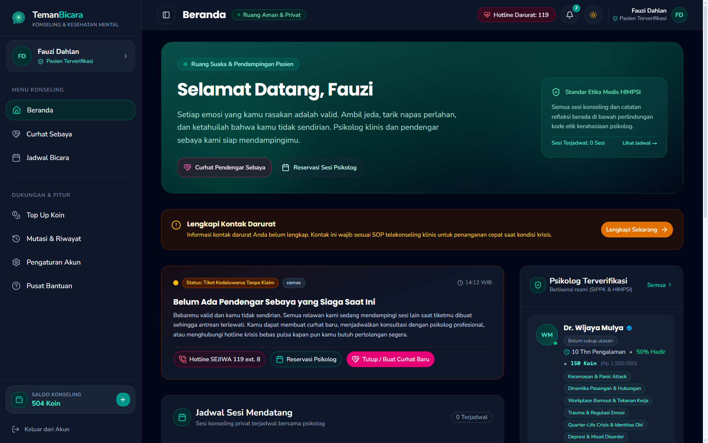 | 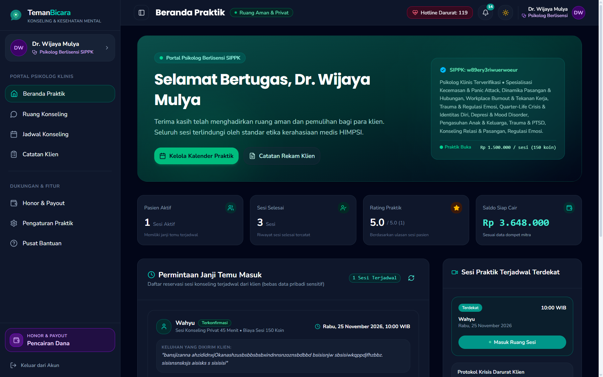 |
| 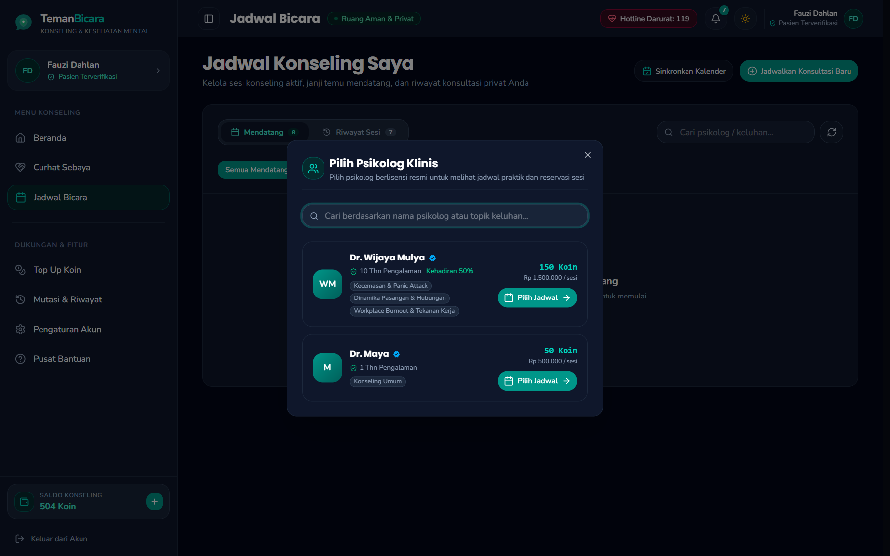 | 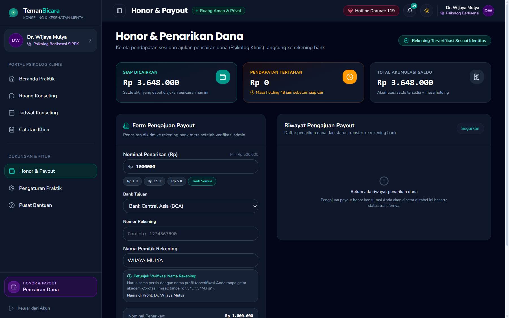 |
|  | 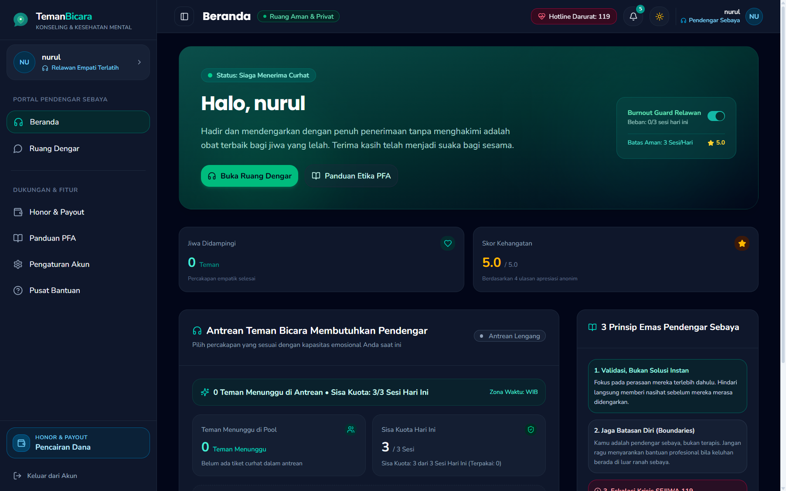 |

| Admin | |
|---|---|
| 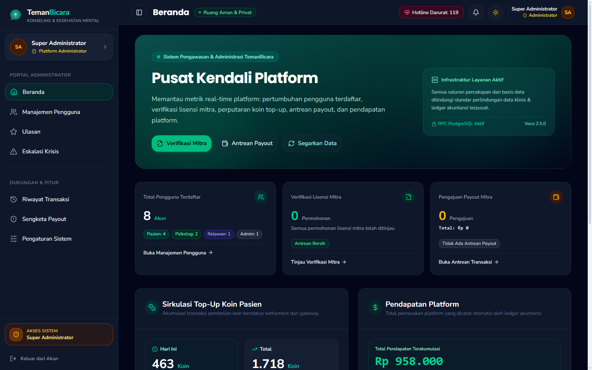 | 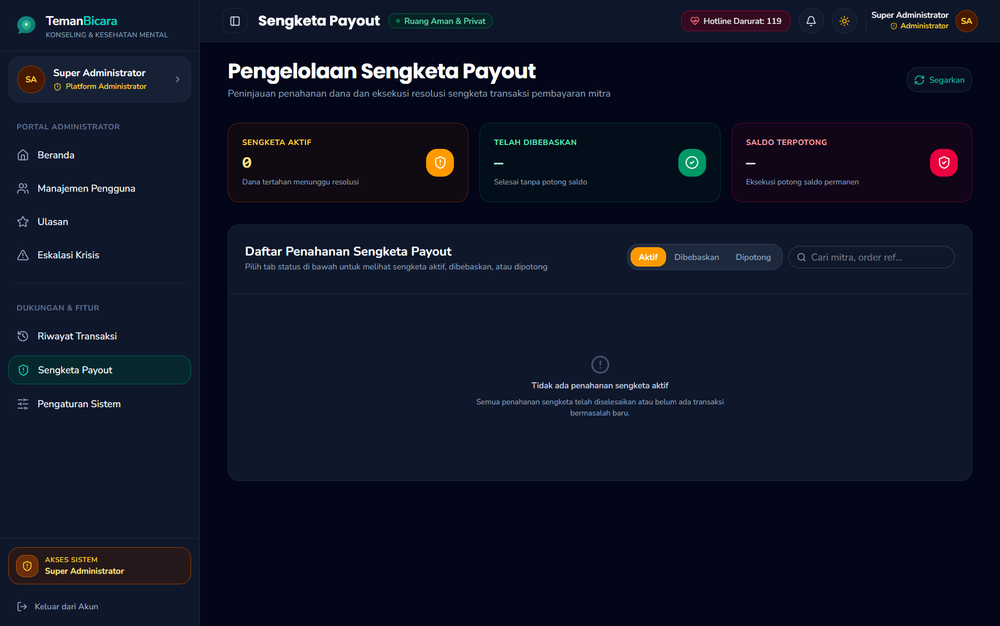 |
|  | |

### Mobile

| Landing | Beranda pasien | Booking sesi | Top-up koin |
|---|---|---|---|
| 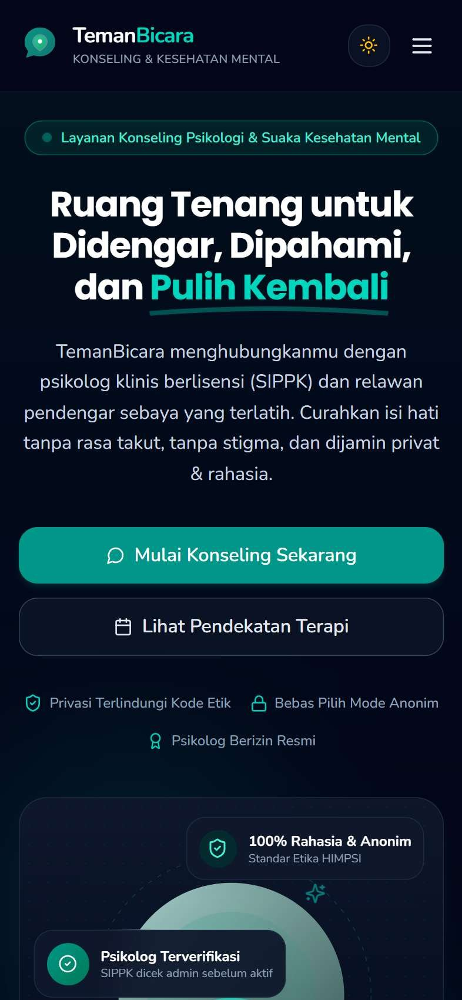 | 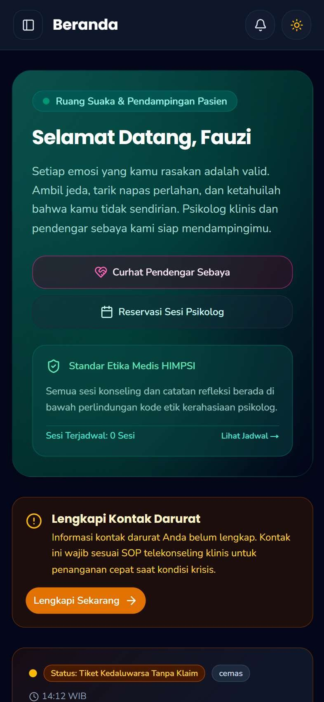 | 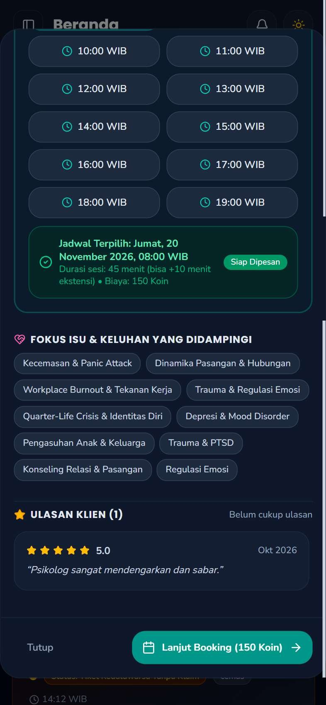 | 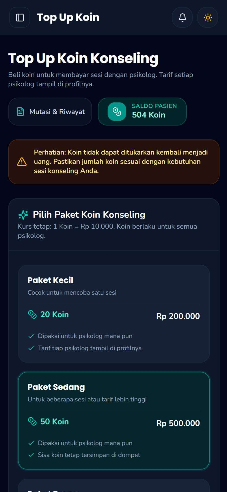 |

| Ruang sesi | Jadwal psikolog | Ruang curhat relawan | Admin |
|---|---|---|---|
| 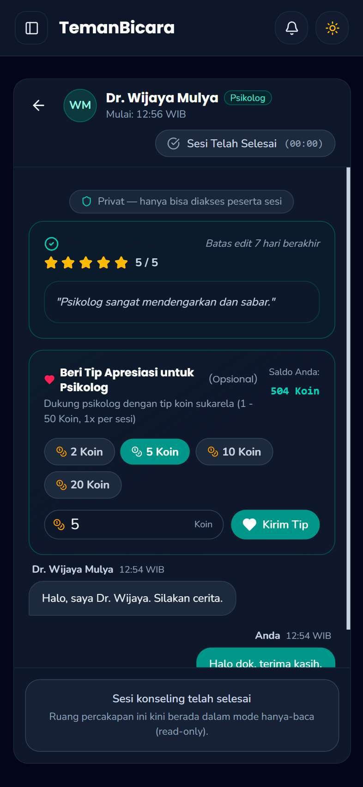 | 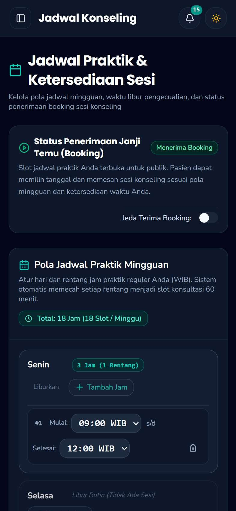 | 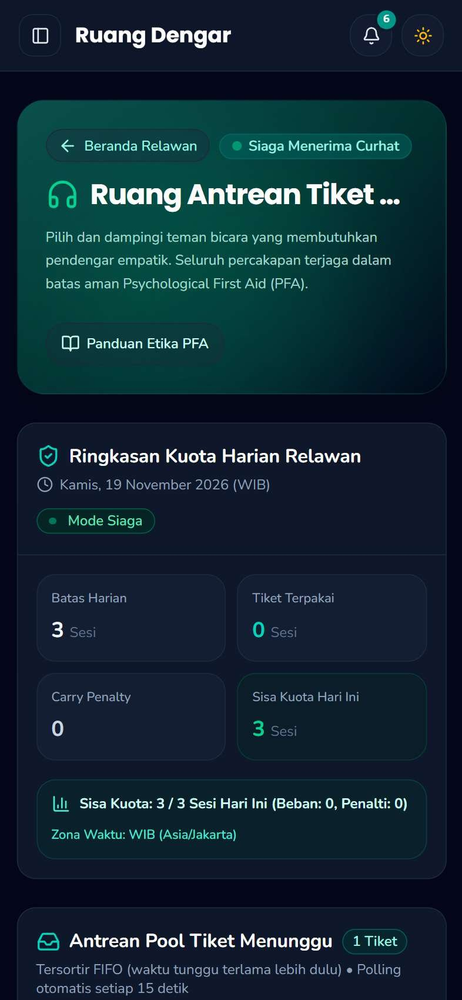 | 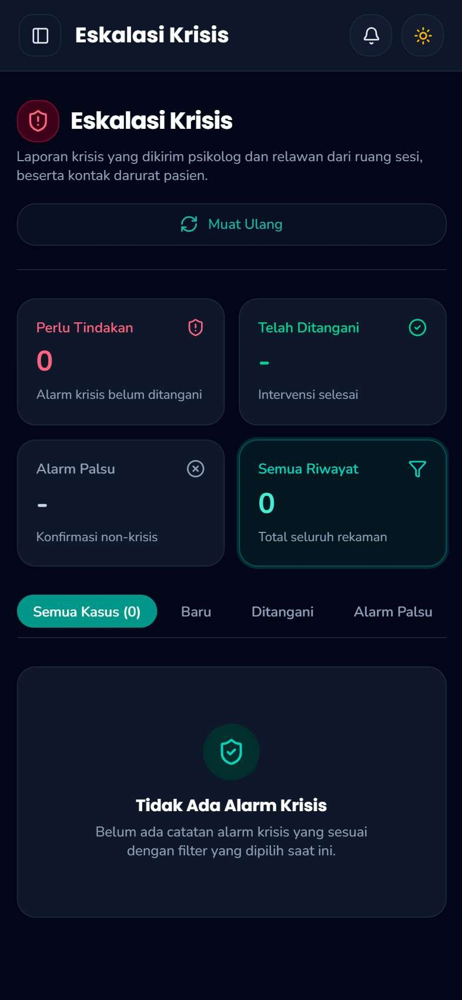 |
