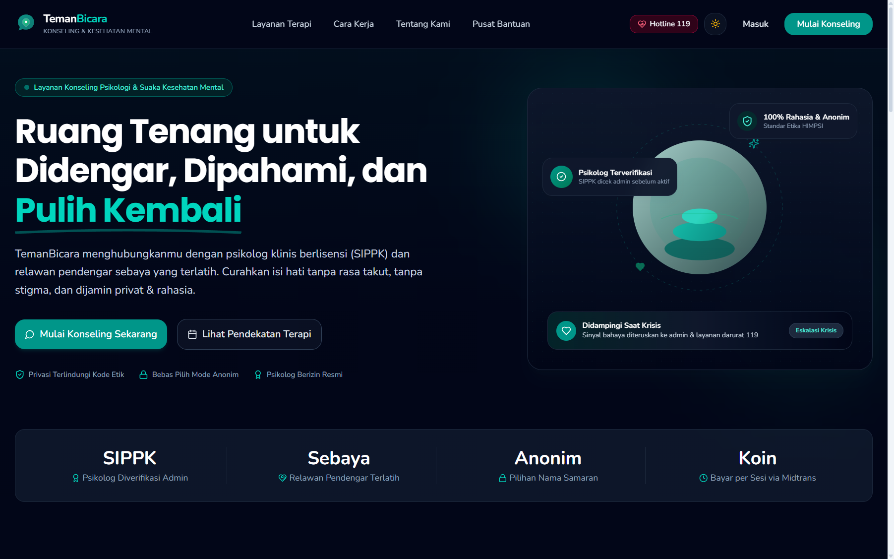
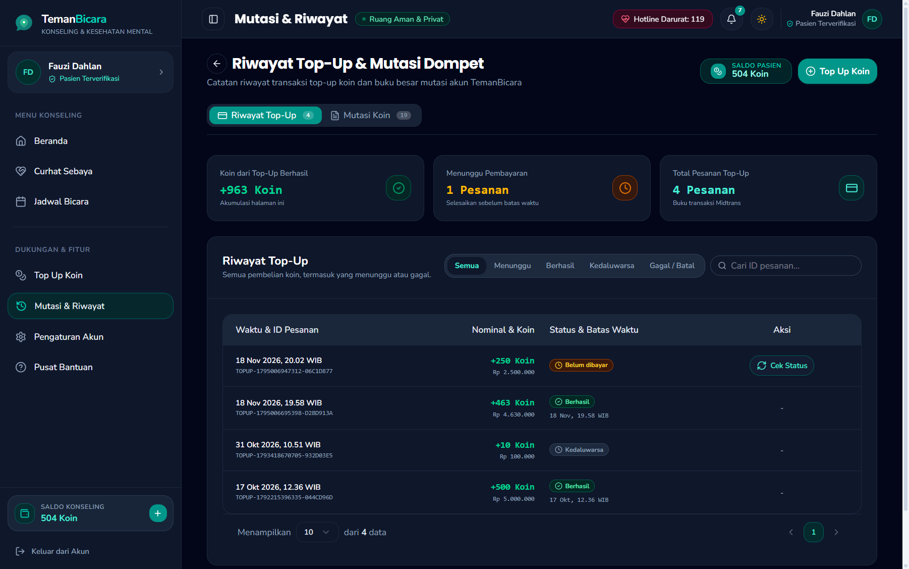
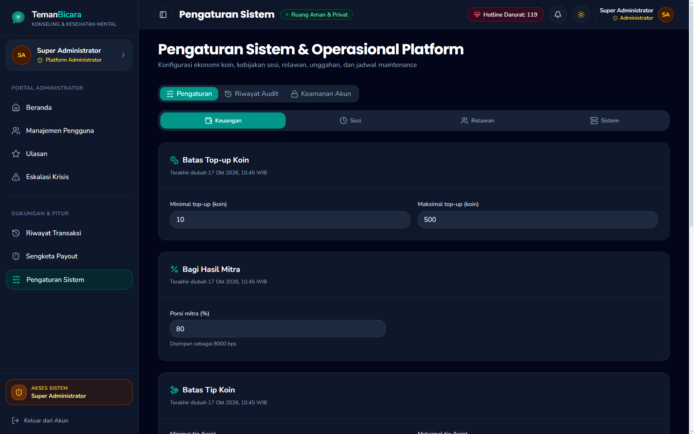

# TemanBicara

Platform konseling dan kesehatan mental. Pasien bisa memesan sesi dengan psikolog, berbagi cerita dengan relawan pendengar sebaya, dan admin memantau seluruh platform.

🔗 **[Demo live](https://temanbicara-app-eight.vercel.app)**



## 📸 Tampilan per Peran

| Pasien | Psikolog |
|---|---|
|  |  |
|  |  |
|  |  |

| Admin | |
|---|---|
|  |  |
|  | |

## Fitur Utama

- **Multi-peran:** Pasien, Psikolog, Relawan Pendengar Sebaya, dan Admin, masing-masing dengan akses dan dashboard sendiri
- **Booking sesi:** pilih psikolog dan jadwal, reschedule, dan batalkan dengan refund otomatis sesuai kebijakan
- **Chat sesi:** pesan teks, gambar, dan pesan suara dalam satu ruang sesi
- **Curhat sebaya:** antrean tiket curhat anonim yang diklaim relawan, dengan batas beban harian
- **Koin dan pencairan:** top-up koin via Midtrans, tip, dan pengajuan payout honor untuk mitra
- **Keuangan yang aman:** buku besar (ledger) append-only, penahanan dana saat refund/chargeback, dan layar admin untuk menyelesaikan sengketa
- **Dashboard admin:** verifikasi mitra, antrean payout, sengketa, feed eskalasi krisis, dan pengaturan sistem beraudit

## Tech Stack

Next.js 15 · React 19 · TypeScript · Tailwind CSS 4 · Zustand · Supabase (PostgreSQL + RLS + Realtime) · Zod · Midtrans · Vitest · Vercel

## Arsitektur Singkat

```
Browser (Next.js App Router, React 19)
   │  cookie HttpOnly
   ▼
API Route Next.js  ── validasi Zod, cek sesi & peran
   │  service role (hanya di server)
   ▼
Supabase PostgreSQL ── RLS, RPC transaksional (saldo, ledger, sengketa), pg_cron
   ▲
Midtrans (sandbox) ── webhook top-up, refund, chargeback
```

Semua mutasi uang (top-up, bayar sesi, tip, payout, potong saldo sengketa) berjalan di fungsi PostgreSQL yang atomik dan tercatat di ledger yang tidak bisa diubah.

## Pengujian

161 tes otomatis (Vitest) untuk alur yang paling berisiko:

| Area | Contoh yang diuji |
|---|---|
| Uang | webhook Midtrans (idempoten, refund, chargeback), payout, tip, resolusi sengketa |
| Login & sesi | token tidak valid, akun ditangguhkan/ditolak, proteksi rute cron |
| Validasi | skema auth, dokumen mitra, path media sesi (anti path traversal) |
| Booking | tarif koin, aturan refund, aturan reschedule, jendela ruang sesi |

```bash
npm test
```

Migrasi SQL juga punya skrip dry-run transaksional di `supabase/tests/` untuk menguji sintaks dan constraint di PostgreSQL sungguhan.

## Mencoba Top-up (Sandbox)

Pembayaran memakai **Midtrans sandbox**, jadi tidak ada uang sungguhan. Saat top-up koin, pakai kartu uji resmi Midtrans:

| Nomor kartu | Masa berlaku | CVV |
|---|---|---|
| `4811 1111 1111 1114` | `12/30` | `123` |

## Keamanan

- Autentikasi memakai cookie HttpOnly dan JWT Supabase yang diverifikasi di server
- Row Level Security di database, dan akses service role hanya dari server
- Validasi input di server dengan Zod, dan pesan error tidak membocorkan detail database
- Webhook Midtrans diverifikasi signature-nya dan diproses secara idempoten

## Menjalankan Secara Lokal

```bash
git clone https://github.com/wxhyxtrx/temanbicara-app.git
cd temanbicara-app
npm install
cp .env.example .env.local   # isi variabel Supabase & Midtrans sandbox
npm run dev
```

## Status

Proyek portofolio, belum untuk penggunaan produksi. Pembayaran berjalan di mode sandbox. Belum tersedia: ekspor PDF, autentikasi dua faktor (2FA), dan pengingat via WhatsApp.
