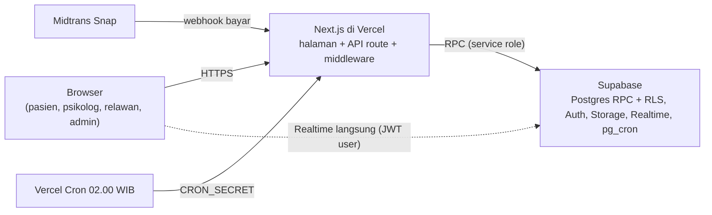

# TemanBicara — Dokumen Serah Terima (Handover)

Per 2026-10-20 · versi yang bisa dibagikan (dengan diagram interaktif): https://claude.ai/code/artifact/4b9afd71-63be-4f74-82e1-ae284e844e36

## 1. Ringkasan proyek & status

TemanBicara adalah aplikasi telekonseling kesehatan mental dengan 4 role (pasien, psikolog, relawan, admin). Fase 3 (booking & sesi psikolog berbayar koin) selesai dibangun dan lulus UAT ulang di semua role pada 2026-10-20; master `778afdf`, auto-deploy ke Vercel.

- **Repo:** GitHub `wxhyxtrx/temanbicara-app`, branch utama `master` (tidak ada branch develop).
- **App:** https://temanbicara-app-eight.vercel.app (project Vercel `temanbicara-app`).
- **Database:** Supabase project "Temanbicara" (`mcciuvlqvvvptgmelexi`) — **khusus development**. Produksi belum dibuat.
- **Tim agen saat ini:** Paul = backend-leader (worktree `temanbicara-be`), Rimuru = frontend-leader (checkout utama `temanbicara`), keduanya agen QwenPaw. Claude berperan PM/tech lead: memecah tugas, review, dry-run + migrasi, merge, tes browser.

| # | Tahap | Status |
| --- | --- | --- |
| 1 | Pengaturan sistem (admin) | Selesai |
| 2 | Dompet: top-up Midtrans, saldo, payout mitra, holding | Selesai |
| 3 | Rapikan admin & pasien | Selesai |
| 4 | Rapikan psikolog & relawan | Selesai |
| 5 | Fase 3 — booking & sesi psikolog | Selesai, menunggu cek akhir owner |
| 6 | Fase 4 — mode maintenance (middleware) | Belum mulai (owner minta tahan dulu) |
| 7 | Fase 5 — relawan & curhat sebaya (tiket, kuota, room 24 jam) | Belum mulai |
| 8 | Pelengkap (lihat bagian PM) | Belum mulai |
| 9 | Rilis: Supabase produksi, env, tes keamanan Postman | Belum mulai |

## 2. Untuk PM: aturan bisnis & keputusan produk

Koin adalah kredit layanan tertutup: pasien tidak pernah bisa mencairkan koin ke uang, dan mitra (psikolog/relawan) hanya memegang saldo rupiah. Ini keputusan sengaja agar tidak masuk regulasi uang elektronik BI. Semua angka di bawah bisa diubah admin di Pengaturan Sistem dan di-*snapshot* ke booking saat dibuat.

**Ekonomi**

| Aturan | Nilai saat ini |
| --- | --- |
| Kurs koin | 1 koin = Rp 10.000 (konstanta kode) |
| Top-up | 10–500 koin, tanpa diskon/paket; Midtrans sandbox |
| Bagi hasil sesi, ekstensi, tip | mitra 80% (`revenue_share.mitra_bps` = 8000), platform 20% |
| Holding pendapatan mitra | 48 jam, lalu cron memindahkan ke saldo tersedia |
| Payout mitra | Rp 500.000–10.000.000, biaya Rp 6.500, disetujui admin, hanya ke rekening atas nama mitra (simulasi) |
| Tip | 1–50 koin per sesi, 1x per sesi, batas harian 100 koin per pasien |

**Booking & sesi (psikolog)**

- Booking instan (tanpa persetujuan psikolog), slot 60 menit tepat di jam (WIB), dari jadwal mingguan + cuti psikolog. Minimal 2 jam sebelum, maksimal 14 hari ke depan; maks 3 booking aktif per pasien, maks 1 per psikolog per hari.
- Durasi sesi 45 menit + 1 ekstensi 10 menit (pasien mengajukan, psikolog menyetujui, koin dipotong di depan). Ruang ditutup paksa di menit ke-58.
- **Pasien batal:** ≥ 60 menit sebelum = refund 100%; 30–60 menit = 65% (dibulatkan ke atas); < 30 menit = 0%. Sisa koin yang hangus dibagi mitra/platform.
- **Pasien pindah jadwal:** sekali saja, minimal 24 jam sebelum sesi.
- **Psikolog batal:** pasien memilih pindah jadwal atau refund 100%; bila tidak memilih, otomatis refund setelah 48 jam atau saat jam sesi. Batal < 24 jam sebelum = 1 strike.
- **Psikolog tidak menyapa** dalam 10 menit setelah jam mulai = sesi batal otomatis, refund 100%, psikolog kena 2 strike.
- **Pasien tidak menyapa** dalam 30 menit setelah sapaan psikolog = no-show, refund 0%, psikolog tetap dibayar.
- **Strike:** 3 poin dalam 30 hari = psikolog disuspensi 7 hari.
- Psikolog hanya melihat nama panggilan pasien (atau "Pasien Anonim"), tidak pernah nama lengkap/email/WA/kontak darurat.
- Catatan klien hanya bisa dibaca psikolog penulisnya; admin pun tidak bisa. Akses admin ke kontak darurat pasien tercatat di log.
- Ulasan publik anonim (rating 1–5, teks ≤ 500), bisa diedit 7 hari setelah sesi; rata-rata tampil setelah ≥ 3 ulasan. Psikolog bisa *melaporkan* ulasan; admin bisa *menyembunyikan* (keluar dari profil publik & rata-rata, tetap terlihat psikolognya dengan label "Disembunyikan admin").
- Media sesi (gambar, voice note maks 3 menit) dihapus 30 hari setelah sesi selesai; teks tetap.
- Notifikasi hanya in-app (lonceng realtime), termasuk pengingat 60 dan 10 menit.
- Teks privasi harus jujur: tidak ada enkripsi end-to-end. Gunakan "Percakapan hanya bisa diakses kamu dan psikologmu".

**Relawan (Fase 5, belum dibangun)**: kuota 3 tiket/hari, klaim tak dijawab 10 menit kembali ke antrean dan memotong kuota, tiket tak diklaim 24 jam diarsipkan dengan saran ke psikolog + hotline.

**Backlog Pelengkap** (diputuskan owner 2026-10-19)

- [ ] Pasien: ganti password, 2FA, preferensi notifikasi sesi, ekspor PDF (saat ini "Coming Soon")
- [ ] Psikolog: rekening bank pencairan (saat ini input non-aktif)
- [ ] Relawan: preferensi notifikasi antrean
- [ ] Log aktivitas admin
- [ ] Paket top-up dikelola admin (saat ini hardcode, hanya pintasan)
- [ ] Hapus kolom lama `psikolog_profiles.saldo`
- [ ] `/api/auth/refresh` memakai klien Supabase per-request (saat ini klien bersama di server)

## 3. Untuk Tech Lead: arsitektur & keamanan

Satu aplikasi Next.js 15 (App Router) melayani UI dan API; semua aturan uang dan status hidup di Postgres sebagai fungsi RPC, bukan di kode TypeScript. Browser tidak pernah menulis langsung ke tabel.

Semua tulisan data lewat Next.js + RPC; hanya langganan Realtime (chat, notifikasi) yang langsung dari browser ke Supabase dengan JWT pengguna.

**Stack:** Next.js 15.4 + React 19, TypeScript, Tailwind 4, Zod 4, Zustand 5, sonner (toast); Supabase (Postgres, Auth, Storage, Realtime, pg_cron); Midtrans Snap (sandbox); Vercel (hosting + Vercel Cron).

**Aturan keamanan yang wajib dijaga**

- Setiap fungsi database: `SECURITY DEFINER` + `SET search_path = ''` + nama ter-kualifikasi (`public.`, `pg_catalog.`), lalu `REVOKE ALL ... FROM PUBLIC, anon, authenticated` dan `GRANT EXECUTE ... TO service_role`.
- API route memanggil RPC lewat `supabaseAdmin` (service role) setelah `getSessionUser()` memverifikasi JWT; identitas selalu diambil dari sesi, tidak pernah dari body request.
- RLS: tabel hanya bisa di-SELECT oleh pemiliknya/peserta; INSERT/UPDATE/DELETE dicabut dari `anon` & `authenticated` (tulis hanya lewat RPC). Cek admin di policy pakai `public.is_admin()` — jangan `EXISTS (SELECT ... FROM users)` di policy tabel `users` (rekursi tak berujung, pernah terjadi).
- Ledger dompet append-only lewat `apply_wallet_ledger_internal`, dengan unique `(reason, ref_type, ref_id, account)` sebagai pengaman dobel-proses. Uji transaksi uang selalu `BEGIN ... ROLLBACK`.
- Data yang dikirim ke psikolog wajib lewat `toPsikologBookingView()` (`src/lib/booking/views.ts`) agar data pribadi pasien tersaring.
- Storage: bucket privat (`session-media`, `dokumen-mitra`), akses via signed URL berumur pendek.

**Auth & sesi login**

- Login (`/api/auth/login`) memakai Supabase password auth, lalu set cookie: `tb_access_token` (JWT, non-httpOnly karena dibaca klien untuk Realtime), `tb_refresh_token` (httpOnly), `tb_user_role` (httpOnly, ditandatangani `ROLE_COOKIE_SECRET`), `tb_user_status`.
- `middleware.ts` mengecek token + role untuk rute `(private)`.
- Respon 401 di klien → coba `POST /api/auth/refresh` sekali, ulangi request; gagal baru `handleUnauthorized()` (logout paksa).
- Jangan pernah menulis cookie `tb_access_token` dari klien kecuali dengan token asli dari login/refresh (bug force-logout 2026-10-18 berasal dari sini).

**Proses latar**

| Job | Jadwal | Fungsi |
| --- | --- | --- |
| `session-tick` (pg_cron) | tiap menit | `public.session_tick()`: pengingat 60/10 menit, batal otomatis psikolog telat, no-show pasien, tutup paksa menit 58, refund otomatis pilihan pasien; tiap baris dibungkus exception agar satu error tidak menghentikan putaran |
| `release-holding-job` (pg_cron) | berkala | pindahkan pendapatan mitra dari holding ke tersedia setelah 48 jam |
| `topup-expire-stale-job` (pg_cron) | berkala | kedaluwarsakan top-up pending |
| Vercel Cron | 02.00 WIB harian | `GET /api/cron/purge-session-media` (header `Authorization: Bearer CRON_SECRET`) hapus media > 30 hari |

**Deploy & env**

- Push ke `master` = deploy produksi Vercel otomatis (pakai Supabase dev saat ini).
- Env wajib (lihat `.env.example`): `NEXT_PUBLIC_APP_URL`, `NEXT_PUBLIC_SUPABASE_URL`, `NEXT_PUBLIC_SUPABASE_ANON_KEY`, `SUPABASE_URL`, `SUPABASE_ANON_KEY`, `SUPABASE_SERVICE_ROLE_KEY`, `ROLE_COOKIE_SECRET`, `NEXT_PUBLIC_PAYMENT_CLIENT_KEY`, `PAYMENT_SERVER_KEY`, `PAYMENT_IS_PRODUCTION`, `PAYMENT_NOTIFICATION_URL`, `CRON_SECRET`. Nilai rahasia hanya di Vercel dan `.env.local`, tidak pernah di git.

## 4. Untuk BE (Paul): database, RPC & API

Skema dibangun oleh 19 migrasi di `supabase/migrations/` (semua sudah diterapkan ke Supabase dev); fungsi yang ditulis ulang di migrasi berikutnya selalu memakai versi terbaru — contoh `session_tick()` versi final ada di 000018.

| No | Migrasi | Isi utama / RPC |
| --- | --- | --- |
| 019 | purge_media | `session_media_mark_purged` |
| 018 | notifications | tabel `notifications`, `notify_internal`, trigger notifikasi di bookings/tips/strikes/profil, `session_tick` + pengingat 60/10 |
| 017 | session_reviews | `session_reviews`, `review_upsert`, `session_tip`, `review_report`, `review_set_hidden`, `psikolog_rating_summary`; `session_tick` tahan-error |
| 016 | client_notes | `client_notes`, `emergency_contact_access_log`, `client_note_upsert` |
| 015 | session_lifecycle | `booking_settle_internal`, `extension_request`, `extension_respond`, `session_end`, `session_tick` + pg_cron `session-tick` |
| 014 | session_messages | `session_messages` (Realtime), trigger pesan pertama, bucket `session-media`, `is_admin()` + perbaikan RLS rekursif |
| 013 | psikolog_cancel_strikes | `psikolog_strikes`, `booking_cancel_by_psikolog`, `booking_choose_refund`, `apply_strike_suspension` |
| 012 | bookings | `bookings`, `booking_create`, `booking_cancel_by_patient`, `booking_reschedule` |
| 011 | available_slots | `psikolog_available_slots` (WIB, cuti, jeda, suspensi) |
| 010 | psikolog_schedule | `psikolog_schedules`, `psikolog_time_off`, `psikolog_schedule_replace` |
| 009 | booking_settings | seed setting `booking`, `strike`, `rating` |
| 008 | pasien_profile_fields | kolom kontak darurat pasien |
| 007 | relawan_profiles_and_dokumen_mitra | kolom relawan, bucket `dokumen-mitra` (PDF ≤ 5 MB) |
| 006 | admin_dashboard_stats | `admin_dashboard_stats` |
| 005 | topup_attach_snap | `topup_attach_snap` |
| 004 | topup_expiry_and_history | `topup_expire_stale` + cron |
| 003 | release_holding_cron | cron `release_holding` |
| 002 | wallet_ledger | dompet & ledger: `apply_wallet_ledger_internal`, top-up, `tip_create`, payout, `release_holding` |
| 001 | system_settings | `system_settings` + audit, `update_system_settings_batch` |

**API (Next.js route handler, `src/app/api/`)**

- Auth: `auth/login`, `auth/logout`, `auth/refresh`, `auth/me`, `auth/oauth/google/callback`, `auth/register/{pasien,psikolog,relawan}`
- Booking & sesi: `bookings` (GET/POST), `bookings/[id]` + `/cancel`, `/reschedule`, `/choose-refund`, `/messages`, `/media-url`, `/extension`, `/extension/respond`, `/end`, `/note`, `/review`, `/review/report`, `/tip`
- Psikolog publik: `psychologists`, `psychologists/[id]`, `/slots`, `/reviews`
- Psikolog: `counselor/schedule`, `counselor/time-off`, `counselor/patients/[patientId]/notes`
- Dompet: `wallet/me`, `wallet/topup` (+ `[order_id]`, `/check`), `wallet/topups`, `wallet/transactions`, `wallet/payout(s)`, `webhooks/midtrans`
- Admin: `admin/settings` (+ `/audit`), `admin/stats`, `admin/payouts` (+ `/paid`, `/reject`), `admin/reviews` (+ `[id]`), `admin/users/[id]/emergency-contact`, `users` (+ `[id]`, `/status`)
- Lain: `users/me`, `notifications` (+ `/read`), `settings/public`, `upload/presigned-url`, `cron/purge-session-media`, `volunteers`

**Cara membuat & menerapkan migrasi**

1. Nomor berikutnya `20261017000020_<nama>.sql`; sertakan file uji `supabase/tests/<nama>_dryrun.sql` (BEGIN … ROLLBACK, assert dengan `RAISE EXCEPTION`).
2. Jalankan dry-run di Supabase dev (SQL editor atau MCP `execute_sql`); tambahkan `RAISE EXCEPTION 'DRYRUN_OK'` di akhir supaya pasti rollback.
3. Baru setelah lulus, terapkan migrasi (MCP `apply_migration`) dan merge kodenya.
4. Jebakan yang pernah terjadi: `$$` bersarang di dalam `DO $$` memutus blok; dua fixture booking dengan psikolog + jam sama melanggar unique slot; `bookings.status` bertipe `text` (bukan enum); `pg_catalog.least` tidak ada (pakai `LEAST`).

## 5. Untuk FE (Rimuru): halaman, komponen & pola

Semua halaman login ada di `src/app/(private)/<role>/`; data selalu dari API (`src/services/*.client.ts`), bukan dari store mock. Beberapa store lama (chat, clinical-records, schedule) masih berisi data dummy dan hanya dipakai halaman lama — jangan dipakai untuk fitur baru.

| Role | Halaman | Catatan |
| --- | --- | --- |
| Pasien | `beranda`, `schedule`, `session/[id]`, `settings`, `top-up`, `top-up/history`, `room` | `room` = fitur lama DASS-21 (bukan ruang sesi). Ruang sesi = `session/[id]` |
| Psikolog | `beranda`, `schedule`, `room?booking=<id>`, `clients`, `earnings`, `settings` | `room` tanpa query = tab Sesi Aktif / Riwayat |
| Relawan | `beranda`, `queue`, `guidelines`, `earnings`, `settings` | Ruang Dengar & antrean = "Segera Hadir" (Fase 5) |
| Admin | `beranda`, `users`, `verifications`, `transactions`, `reviews`, `settings`, `crisis-feed` | menu `reviews` bernama "Ulasan" |
| Publik | `/`, `login`, `register` (+ `counselor`, `listener`), `status`, `help-center` | |

**Komponen kunci**

- Booking: `components/views/schedule/booking-modal.tsx`, `patient/psychologist-profile-modal.tsx`, `schedule/booking-card.tsx`, modal batal / pindah / pilih refund di `schedule/`.
- Ruang sesi: `components/views/session/session-room-view.tsx` (chat, timer, ekstensi, akhiri) + `session-notes-placeholder.tsx` (panel catatan psikolog).
- Notifikasi: `components/shared/organisms/notification-dropdown.tsx`; sidebar & logout: `sidebarApp.tsx`.

**Pola yang wajib diikuti**

- **Realtime:** sebelum `.channel().subscribe()`, panggil `supabasePublic.realtime.setAuth(token)` dengan token dari cookie `tb_access_token`; tanpa itu RLS memblok event. Selalu sediakan fallback polling (pesan 5 detik, notifikasi 30 detik) dan dedupe berdasarkan `id`.
- **Auth di klien:** jangan menulis cookie token sendiri. `setAuthSession(user, undefined, profile)` hanya memperbarui data user. 401 ditangani interceptor (refresh dulu, logout bila gagal).
- **Modal:** isi dialog wajib `min-w-0`; teks `truncate` di dalam flex butuh `min-w-0` di wadahnya, kalau tidak dialog melebar (bug berulang di modal profil & konfirmasi booking).
- Tampilkan skeleton saat memuat, pesan error dari server, dan empty state. Waktu selalu WIB.
- Teks privasi harus jujur (lihat bagian PM); fitur yang belum ada = label "Coming Soon", bukan data palsu.
- Sebelum serah: `npx tsc --noEmit` dan `npm run build` harus lulus.

## 6. Runbook: cara kerja sehari-hari

Satu tugas = satu branch dari `master`; hanya fast-forward ke `master`, lalu push = deploy.

**Menjalankan lokal**

1. `npm install`, salin `.env.example` ke `.env.local` dan isi nilai dari owner (jangan commit).
2. `npm run dev` → http://localhost:3000. Jangan jalankan `npm run build` di folder yang sama saat dev server menyala (folder `.next` rusak, API jadi 500) — restart dev server sesudahnya.

**Alur satu tugas**

1. PM/TL menulis tugas: file yang disentuh, kriteria selesai, aturan (BE hanya backend, FE hanya frontend).
2. Agen: `git checkout master && git checkout -b <feat|fix>/<nama>`, kerjakan, commit per bagian, `npx tsc --noEmit && npm run build`. Agen tidak merge/push.
3. Bila ada migrasi: TL menjalankan dry-run (BEGIN…ROLLBACK) → lulus → `apply_migration`.
4. TL review diff (tidak ada `.env`, `docs/` rahasia, atau `scripts/` internal), tes di browser lokal per role.
5. Merge: bila `git merge-base --is-ancestor master <branch>` → `git fetch . <branch>:master && git push origin master`. Bila master sudah maju dan file tidak bentrok, minta agen `git rebase master` (atau cherry-pick di worktree sementara path pendek, mis. `C:/tbmw`).
6. Cek deployment Vercel sampai `READY`, lalu laporkan ke owner: apa yang selesai dan apa yang perlu dicek.

**Agen QwenPaw**

- Kirim tugas: `qwenpaw agents chat --background --from-agent default --to-agent backend-leader|frontend-leader --text "..."` → dapat `task-id`; cek: `qwenpaw agents chat --background --task-id <id>`.
- Persetujuan perintah: `GET http://127.0.0.1:8088/api/approval/list`, setujui yang aman lewat `POST /api/approval/approve {request_id, session_id, scope:"exact"}`. Timeout 300 detik.
- Agen sering berhenti di batas 100 langkah: pecah tugas kecil, minta commit tiap bagian, dan saat melanjutkan sebutkan apa yang sudah ter-commit.
- Dua agen tidak boleh membangun di folder yang sama bersamaan; Paul di worktree `temanbicara-be`, Rimuru di checkout utama.

**Saat mengetes sesi**

- Untuk mempercepat jam sesi di DB dev, majukan `start_at` booking tes, lalu **psikolog segera mengirim pesan pertama** — bila tidak, cron membatalkan sesi dan memberi psikolog 2 strike.

## 7. Riwayat bug penting, isu terbuka & akun testing

Bug paling mahal sejauh ini adalah force-logout dalam hitungan menit (2026-10-18), penyebabnya cookie token yang ditimpa kode klien — bukan token kedaluwarsa seperti dugaan awal. Pelajaran umum: cek log Auth Supabase sebelum menebak.

| Tanggal | Bug | Penyebab | Perbaikan |
| --- | --- | --- | --- |
| 2026-10-20 | Modal konfirmasi booking melebar, tombol bayar di luar layar | teks `truncate` di flex tanpa `min-w-0` | `778afdf` |
| 2026-10-18 | Force logout setelah simpan profil, jeda booking, buka beranda relawan | `setAuthSession` menulis cookie `tb_access_token=session-token` saat token kosong | `3b74aa5` + refresh token `f6c99cd` |
| 2026-10-18 | Chat sesi tidak realtime | subscribe Realtime tanpa token user, RLS memblok | `setAuth` + polling fallback |
| 2026-10-18 | Simpan catatan klien selalu gagal | cast ke enum `booking_status` yang tidak ada | diperbaiki sebelum migrasi 016 |
| 2026-10-18 | Satu booking error menghentikan seluruh putaran cron | `session_tick` tanpa exception per baris | migrasi 017 |
| 2026-10-17 | Policy `users` rekursi tak berujung | `EXISTS(SELECT ... FROM users)` di policy tabel itu sendiri | `is_admin()` di migrasi 014 |

**Isu terbuka**

- Fase 4 (mode maintenance) belum dimulai — owner minta ditahan sampai ada keputusan.
- Fitur relawan inti (Ruang Dengar, antrean tiket) = Fase 5.
- Backlog Pelengkap ada di bagian 2; rilis produksi butuh Supabase baru + pengujian keamanan endpoint (Postman) sesuai rencana tahap 9.
- Dokumen desain & rencana Fase 3 lengkap: `docs/specs/2026-10-17-fase3-booking-sesi-design.md` dan `docs/superpowers/plans/2026-10-17-fase3-booking-sesi.md`; catatan UAT: `docs/qa/2026-10-18-temuan-uat-fase3.md` (saat ini hanya di laptop owner, di luar git).

**Akun testing (Supabase dev saja)**

Password tidak ditulis di dokumen ini. Daftar lengkap disimpan owner di `docs/akun-test.md` (tidak masuk git) dan dibagikan langsung ke tiap anggota tim.

| Role | Email | Catatan |
| --- | --- | --- |
| Admin | admin@temanbicara.id | super administrator |
| Psikolog | wijaya@gmail.com | Dr. Wijaya Mulya, jadwal Sen/Rab 09–12 WIB (+ slot lain bila diubah), tarif 150 koin |
| Relawan | nurul@mail.com | |
| Pasien | fauzi@mail.com | saldo ± 44 koin per 2026-10-20 (perlu top-up untuk booking 150 koin) |
| Pasien | pasien.uji@example.com | saldo 0 |
