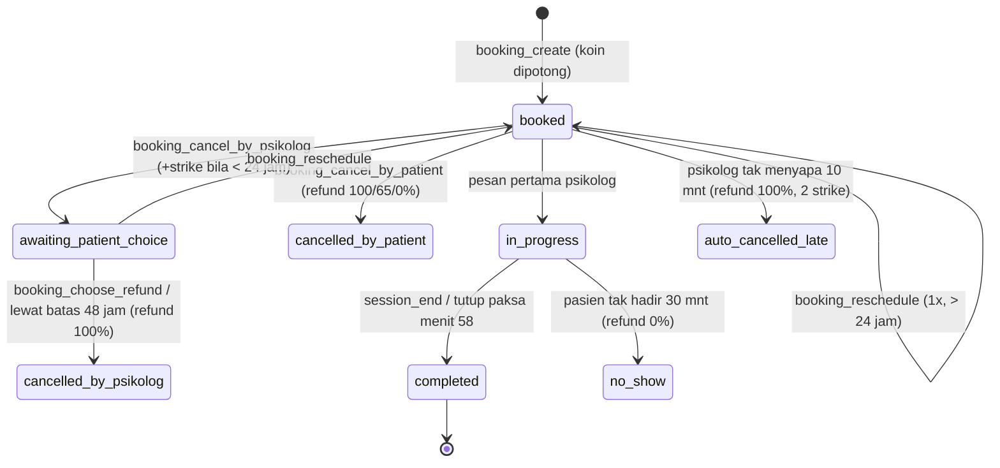

# SDD — Model data & RPC TemanBicara

Status per 2026-10-20 · migrasi s.d. `000019` sudah diterapkan di Supabase DEV (`mcciuvlqvvvptgmelexi`). Sumber kebenaran: folder `supabase/migrations/`. Kalau dokumen ini beda dengan migrasi, **migrasi yang benar** — laporkan ke SA.

## Aturan arsitektur (wajib)

- Semua tulis data penting lewat **RPC** `SECURITY DEFINER` + `SET search_path = ''`; `REVOKE` dari PUBLIC/anon/authenticated, `GRANT EXECUTE` ke `service_role`. API route memanggil RPC dengan service client.
- RLS aktif di semua tabel; admin dicek dengan `public.is_admin()`.
- Uang: ledger **append-only** lewat `apply_wallet_ledger_internal` (idempoten: unique `(reason, ref_type, ref_id, account)`). Jangan pernah `UPDATE wallets` langsung.
- Data booking ke psikolog wajib lewat `toPsikologBookingView` (sembunyikan nama asli/kontak pasien).
- Angka bisnis dibaca dari `system_settings`, jangan di-hardcode.
- Migrasi baru: nomor urut berikutnya (`000020_...`), uji dry-run `BEGIN … ROLLBACK` dulu; SA yang menerapkan.

## Enum

| Enum | Nilai |
| --- | --- |
| `user_role` | pasien, relawan, psikolog, admin |
| `account_status` | active, unverified_email, incomplete_profile, pending_approval, pending_verification, rejected, suspended |
| `payment_status` | pending, settlement, deny, expire, cancel, refund |
| (legacy, tidak dipakai) | verification_status, session_status, peer_status, crisis_risk_level |

## Tabel

### Pengguna & profil
| Tabel | Kolom penting |
| --- | --- |
| `users` | id (= auth.users.id), email, no_wa, google_id, role, status, avatar_url, is_email_verified |
| `admin_profiles` | user_id, nama_lengkap, level |
| `pasien_profiles` | user_id, nama_lengkap, nama_panggilan, kontak_darurat_nama, kontak_darurat_wa, is_anonim_default |
| `psikolog_profiles` | user_id, nama_lengkap_gelar, nomor_sipp_str, dokumen_sipp_str_url, spesialisasi text[], tahun_pengalaman, tarif_sesi, verified_at, rejection_reason, booking_paused, extension_price_coins, suspended_until, `saldo` (legacy, jangan dipakai) |
| `relawan_profiles` | user_id, nama_lengkap, latar_belakang, dokumen_cv_url, alasan_bergabung, total_sesi, alias_name, is_available, topik_keahlian text[], rating_rata_rata |

### Jadwal & disiplin psikolog
| Tabel | Kolom penting |
| --- | --- |
| `psikolog_schedules` | psikolog_id, weekday, start_hour, end_hour (WIB) |
| `psikolog_time_off` | psikolog_id, start_at, end_at, reason |
| `psikolog_strikes` | psikolog_id, booking_id, points, reason (`late_cancel` \| `noshow`) |

### Booking & sesi
| Tabel | Kolom penting |
| --- | --- |
| `bookings` | id, patient_id, psikolog_id, start_at, status, keluhan, price_coins, mitra_share_bps, extension_price_coins, refund_policy jsonb (snapshot saat booking), patient_display_name, reschedule_count, psikolog_first_msg_at, patient_first_msg_at, psikolog_late, extension_status, extension_coins, ended_at, cancelled_at, choice_deadline_at, refund_coins, reminded_60_at, reminded_10_at |
| `session_messages` | booking_id, sender_id, kind (`text` \| `image` \| `voice`), body, media_path, duration_seconds |
| `client_notes` | booking_id (PK), psikolog_id, patient_id, body (≤ 5000) — hanya penulis yang bisa baca |
| `session_reviews` | booking_id (PK), patient_id, psikolog_id, rating 1–5, review (≤ 500), is_hidden, reported_at |
| `notifications` | user_id, type, title, body, link, read_at (realtime) |
| `emergency_contact_access_log` | admin_id, patient_id, waktu akses |

### Dompet & uang
| Tabel | Kolom penting |
| --- | --- |
| `wallets` | user_id, coin_balance, pending_rupiah, available_rupiah |
| `ledger_entries` | user_id, account (`patient_coins` \| `mitra_pending` \| `mitra_available` \| `platform_revenue` \| `payout_disbursement`), amount, unit (`coin` \| `rupiah`), reason, ref_type, ref_id |
| `mitra_earnings` | mitra_id, amount_rupiah, source_type (`tip` \| `session` \| `extension` \| `refund_share`), source_id, available_at, released_at |
| `tips` | patient_id, mitra_id, coins, mitra_share_bps, source_type (`session` \| `ticket`), source_id |
| `topup_orders` | order_id, patient_id, coins, amount_rupiah, status (payment_status), provider_reference, settled_at, expires_at, snap_redirect_url |
| `payout_requests` | mitra_id, amount_rupiah, fee_rupiah, bank_name, account_number, bank_account_name, status (`requested` \| `paid` \| `rejected`), decided_by |

### Pengaturan
| Tabel | Isi |
| --- | --- |
| `system_settings` | key, value jsonb, updated_by |
| `system_settings_audit` | riwayat perubahan (diff) |

Kunci `system_settings` (default): `booking` {min_hours_before 2, max_days_ahead 14, max_active_per_patient 3, max_per_psikolog_per_day 1, reschedule_min_hours 24, psikolog_cancel_free_hours 24, choice_deadline_hours 48} · `strike` {threshold 3, window_days 30, suspend_days 7, per_late_cancel 1, per_noshow 2} · `rating` {window_days 7, min_count_to_show 3} · `revenue_share` {mitra_bps 8000} · `holding` {hours 48} · `psikolog_late` {minutes 10} · `patient_noshow` {minutes 30} · `refund_policy` (tier) · `tip` (1–50, batas harian 100) · `topup` (10–500 koin) · `payout` {min 500000, max 10000000, fee 6500} · `extension_price` (1–10 koin) · `upload` {chat_media_max_mb 10, verification_max_mb 5, voice_note_max_seconds 180} · `media_retention` {days 30} · `relawan` {daily_ticket_quota 3, claim_response_minutes 10, unclaimed_archive_hours 24, max_carry_penalty 1} · `maintenance`.

## Alur status booking

Ekstensi (`extension_status`): `requested` → `approved` (koin pasien dipotong, +10 menit) atau `declined`. Settlement uang ke mitra terjadi di `booking_settle_internal` (80% ke `mitra_pending`, cair setelah 48 jam oleh `release_holding`).

## RPC

| Grup | Fungsi (parameter) → hasil |
| --- | --- |
| Admin | `is_admin()` → bool · `admin_dashboard_stats(p_today_start)` → jsonb · `update_system_settings_batch(p_entries jsonb, p_user_id)` · `notify_internal(user, type, title, body, link)` → uuid |
| Booking | `booking_create(p_booking_id, p_patient_id, p_psikolog_id, p_start_at, p_keluhan)` → bookings · `booking_cancel_by_patient(booking, patient)` · `booking_cancel_by_psikolog(booking, psikolog)` · `booking_choose_refund(booking, patient)` · `booking_reschedule(booking, patient, new_start_at)` (semua → bookings) · `booking_settle_internal(booking, outcome)` |
| Sesi | `session_end(booking, psikolog)` → bookings · `extension_request(booking, patient)` → bookings · `extension_respond(booking, psikolog, approve)` → `'approved'` \| `'declined'` \| `'insufficient_coins'` · `client_note_upsert(booking, psikolog, body)` · `session_tick()` → int (pg_cron tiap menit) · `session_media_mark_purged(uuid[])` → int |
| Jadwal | `psikolog_available_slots(psikolog, from, to)` → setof timestamptz · `psikolog_schedule_replace(psikolog, p_weekly jsonb)` · `apply_strike_suspension(psikolog_id)` |
| Ulasan & tip | `review_upsert(booking, patient, rating, review)` · `review_report(booking, psikolog)` · `review_set_hidden(booking, is_hidden)` · `psikolog_rating_summary(psikolog)` → (rating_avg, rating_count) · `session_tip(tip_id, booking, patient, coins)` · `tip_create(tip_id, patient, mitra, coins, source_type, source_id)` |
| Dompet | `apply_wallet_ledger_internal(user, account, delta, unit, reason, ref_type, ref_id)` · `topup_order_create(order_id, patient, coins, expires_at)` → uuid · `topup_attach_snap(order_id, redirect_url)` · `topup_settle(order_id, provider_ref, paid_amount)` · `topup_fail(order_id, status, provider_ref)` · `topup_expire_stale(batch)` → int · `release_holding(batch)` → int · `payout_request(payout_id, mitra, amount, bank_name, account_number, account_name)` · `payout_mark_paid(payout, admin)` · `payout_reject(payout, admin)` |

## Job terjadwal

| Job | Jadwal | Isi |
| --- | --- | --- |
| pg_cron `session-tick` | tiap menit | `session_tick()` — pengingat, auto-cancel, no-show, tutup paksa, refund otomatis (error per baris ditangkap) |
| pg_cron `release-holding-job` | berkala | `release_holding` — cairkan pendapatan mitra setelah 48 jam |
| pg_cron `topup-expire-stale-job` | berkala | `topup_expire_stale` |
| Vercel Cron `/api/cron/purge-session-media` | `0 19 * * *` (02.00 WIB) | hapus media sesi > 30 hari; butuh header `CRON_SECRET` |

## Auth & sesi login

Cookie: `tb_access_token` (JWT, non-httpOnly), `tb_refresh_token` (httpOnly), `tb_user_role` (ditandatangani `ROLE_COOKIE_SECRET`), `tb_user_status`. Klien kena 401 → coba `/api/auth/refresh` sekali → gagal = logout. Realtime butuh `supabasePublic.realtime.setAuth(token)` + polling cadangan.
